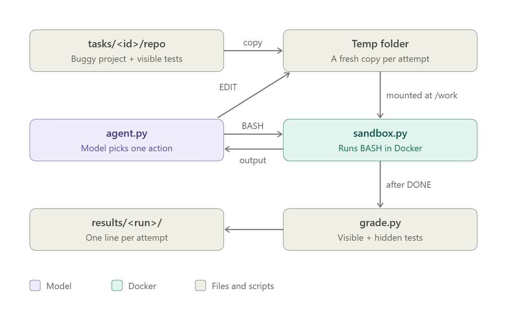
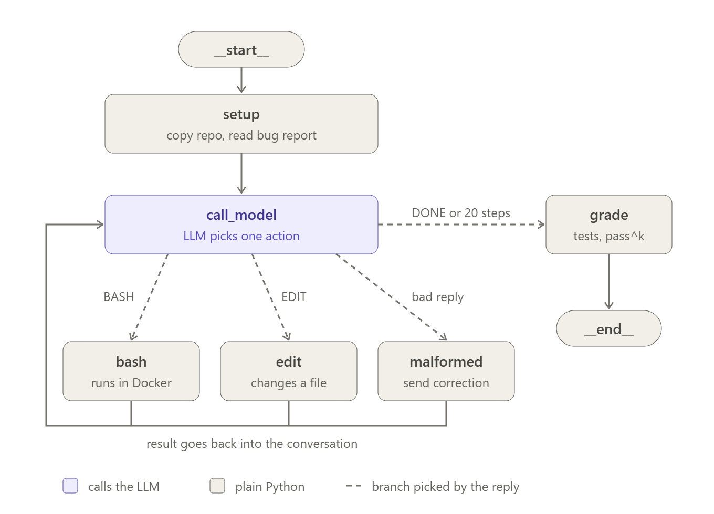
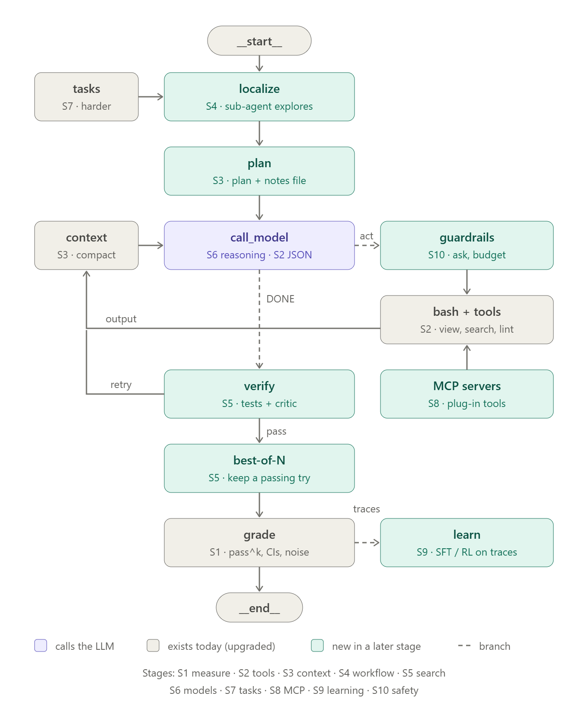

# local-coding-agent

A teaching-sized harness that answers one question: **how reliably does a small coding AI running on
your own GPU fix bugs?** Not just "can it fix a bug once", but "does it fix it every time?"

The harness gives a local model a small Python project with a planted bug, lets it run commands and
edit files inside a Docker sandbox, grades the result with tests it never saw, and repeats each of its 119 tasks
3 times. The whole harness is about 400 lines of plain Python, with no dependencies beyond the
standard library (plus `pytest` for the tests). It is built to grow, one measured stage at a time, into a
system with every modern agent component.



## The agent as a graph

The same agent drawn the way LangGraph draws agents: **nodes** are steps, **solid edges** always happen, and
**dashed edges** are branches chosen by the model's reply.



- `setup` copies the buggy project into a temp folder and reads the bug report (`run.py`).
- `call_model` sends the conversation to the local LLM and gets one reply (`agent.ask_model`), with or without
  thinking for a reasoning model (`LLM_THINK`).
- `open files` re-reads the (at most 2) files the agent viewed or edited most recently and shows them,
  with line numbers, at the end of every prompt, so the model edits the real code, not its memory of it.
- The reply's action picks the next node through the `TOOLS` dict in `tools.py`: `bash` runs a command in
  Docker, `view` shows a file with line numbers, `search` finds text, `edit` changes a file, `malformed` sends
  a correction. Each result goes back into the conversation, and the loop repeats.
- `DONE`, or running out of 20 steps, leads to `verify`: the harness runs the visible tests itself. If they
  fail, the agent gets **one retry**: a fresh conversation whose bug report carries a lesson (what the failed
  try changed in `src/` and how the tests still fail). Otherwise, and after the retry, `grade` (`grade.py`).

Where it is going: the planned graph. Every node is tagged with the stage that adds it.



## The files

Read them in this order:

| File | Lines | What it does |
|---|---|---|
| [`sandbox.py`](sandbox.py) | 30 | Runs one shell command in a fresh Docker container that sees only the task's folder, with `tests/` and `pytest.ini` read-only: no network, 1 CPU, 768 MB, non-root, 30-second limit |
| [`agent.py`](agent.py) | 93 | The agent loop: send the conversation to the model, read **one** action from its reply, run the matching tool, add the result, repeat (max 20 steps). Then verify with the visible tests, and retry once with a lesson if they fail |
| [`tools.py`](tools.py) | 84 | The agent's tools (`bash`, `view`, `search`, `edit`) and the `TOOLS` dict that maps each action name to one. Adding a tool = one function + one dict line |
| [`grade.py`](grade.py) | 27 | After the agent stops: check the tests were not edited, then run the visible tests and the hidden tests |
| [`run.py`](run.py) | 73 | Runs every task 3 times and writes one line per attempt to `results/<run>/results.jsonl`, plus a step-by-step trace. Each line also records tokens, the git commit, the model digest, the Ollama version and the thinking settings |
| [`report.py`](report.py) | 51 | Prints how often each task passed, pass@1, pass-all, why attempts failed, how many got a retry, how often the tests failed exactly as before (stalls), how many edits applied, tokens per attempt and per success, and pass@1 on the held-out tasks |
| [`bestofn.py`](bestofn.py) | 30 | Best-of-N from a run's repeats: keep the first attempt whose visible tests pass, for N = 1, 2, 3, with tokens per task |
| [`stats.py`](stats.py) | 44 | Is a result real? pass@k vs pass^k, a 95% confidence interval, the run-to-run noise band, and a verdict when comparing two runs |
| [`utils.py`](utils.py) | 164 | Small helpers that keep the files above short: shorten output, fix indentation, diff folders, JSON lines, pass@k / pass^k maths, bootstrap, provenance, finding functions, their local names and test docstrings, the stall fingerprint, the retry lesson |
| [`make_tasks.py`](make_tasks.py) | 156 | Makes the tasks: breaks one line of a correct project in `corpus/` and keeps the bug only if the tests catch it |

Plus [`system_prompt.txt`](system_prompt.txt) (the instructions the model gets), [`tasks/`](tasks/)
(the 119 bugs), [`make_tasks.py`](make_tasks.py) with [`corpus/`](corpus/) (how the bugs are made, below) and
[`tests/test_minimal.py`](tests/test_minimal.py) (tests for the harness itself).

**How the tasks are made.** [`corpus/`](corpus/) holds 15 small, correct projects (one to three files, helpers up
to a few calls deep), each with visible tests and hidden tests whose docstrings say what users expect.
`make_tasks.py` breaks one line the way people do (`<=` becomes `<`, `+ 1` becomes `- 1`, `min` becomes `max`, a
line is deleted, a `return` loses its value, a variable is swapped for another one of the same function, a copy
is dropped, ...) and keeps the bug only if the
code still parses, some visible **and** some hidden tests fail, and some visible tests still pass. The bug report
lists the docstrings of the failing visible tests. D1 = the bug is in a function the tests call, D2 = in a helper
one call away, D3 = two bugs in two files. It is plain mutation testing: no model, no GPU, a few minutes on the CPU.

## How one attempt works

1. **Copy.** `run.py` copies `tasks/<id>/repo` (the buggy project plus its visible tests) into a
   new temporary folder. The original task files are never changed.
2. **Prompt.** `agent.py` sends the model two messages: the system prompt (how to act) and the bug
   report from `tasks/<id>/prompt.txt`.
3. **Act.** The model answers with a little reasoning and **one** action in a fenced block:

   ````
   The test expects [2, 3] but gets []. Let me look at the code.
   ```
   BASH: cat src/ringlog.py
   ```
   ````

   | Action | What happens |
   |---|---|
   | `BASH: <command>` | `sandbox.py` runs it in Docker against the temp folder. The exit code and output, shortened to 3,000 characters (enough for every task file), go back to the model |
   | `VIEW: <file>` or `VIEW: <file> 10-30` | `tools.py` shows the file, or some lines of it, with line numbers |
   | `SEARCH: <text>` | `tools.py` lists every line containing the text in the project's `.py` files, as `file:line: code` |
   | `EDIT: <file>` with `<<<<<<< OLD` / `=======` / `>>>>>>> NEW` | `tools.py` replaces the OLD text with the NEW text in the temp folder. OLD must appear exactly once; wrong indentation and line numbers copied from VIEW are tolerated; an edit that would break Python syntax, or that targets `tests/` or `pytest.ini`, is refused and nothing is saved |
   | `DONE` | The agent stops |

   A reply without exactly one action block is **malformed**: nothing runs, the model is told so,
   the step still counts, and the bad reply is left out of the conversation so the model does not
   copy it.
4. **Repeat** until `DONE` or 20 steps. The model always sees the system prompt, the bug report, the
   last 10 messages, and the current content of the 2 files it viewed or edited most recently, read fresh
   from disk. That stays well inside its 8,192-token context window.
   **Verify:** the harness then runs the visible tests itself. If they fail, the agent gets one more try
   of 20 steps with a fresh conversation, whose bug report carries a lesson from the failed try.
5. **Grade.** `grade.py` checks whether `tests/test_visible.py` or `pytest.ini` was changed
   (tampering; the tests are mounted read-only, so this should never happen). It then puts the original tests back, adds `tasks/<id>/hidden/test_hidden.py`, and
   runs both test files in Docker. An attempt **passes** only if both pass and nothing was
   tampered with. Saying `DONE` proves nothing.
6. **Record.** One JSON line per attempt: passed or not, the outcome (`passed`, `wrong_fix`,
   `ran_out_of_steps`, `tampered`), steps, tries, malformed replies, seconds, the seed, and the diff of what
   the agent changed.

**Seeds.** The model picks words with some randomness (temperature 0.7), which is why repeats
differ. Each call sends a seed derived from (task, repeat, step), so the same attempt can be
re-sampled the same way.

## Run it

```bash
# 1. a local model (Ollama): qwen3.5 4B, 4-bit, pinned to an 8k context window (ollama/ has other Modelfiles)
ollama pull qwen3.5:4b
ollama create arh-qwen3.5-4b-8k -f ollama/Modelfile.qwen3.5-4b

# 2. the sandbox image (Python 3.12 + pytest, non-root user)
docker build -t agent-reliability-sandbox:1 docker/

# 3. check the harness itself (fake model + real Docker grading)
python -m pytest -q

# 4. run: 119 tasks x 3 repeats (about 7 hours on an RTX 3060 laptop GPU), or only the first 45 (about 3 hours)
python run.py --run-id baseline
python run.py --run-id baseline-45 --tasks tasks/bench-45.txt
python report.py results/baseline
python stats.py results/baseline                      # CI, pass^k, noise band
python stats.py results/baseline results/my-change    # is a change real or luck?
python bestofn.py results/baseline                     # success vs compute, best-of-N
```

Quick try: `python run.py --run-id smoke --repeats 1 --tasks ringlog-d1,workdays-d1`.
Interrupted runs resume where they stopped, but only with the same commit and model: if either
changed, `run.py` stops and asks for a new `--run-id`, so one run never mixes two experiments. Point it at
another model with `LLM_MODEL` and `LLM_BASE_URL` (any OpenAI-compatible server; the model digest and server
version are read from Ollama and recorded as "unknown" elsewhere).
For a reasoning model, `LLM_THINK` is sent as `reasoning_effort` (`none`, the default, turns thinking off) and `LLM_MAX_TOKENS`
raises the reply limit (768), since thinking tokens count against it. Both are recorded in every result line.

## What this measures

- **pass@1** = the share of all attempts that passed: how often it works.
- **pass-all** = the share of tasks that passed in every repeat: how *reliably* it works.
- **pass@k** = the chance that *at least one* of k tries passes (capability). **pass^k** = the chance that *all* k
  tries pass (reliability). pass^k for k = the number of repeats is pass-all, estimated from the data.
- **95% confidence interval**: resample the tasks 10,000 times (bootstrap) and see how much pass@1 moves.
- **Noise band**: each repeat is a full pass over all tasks, so the spread between repeats is pure luck. Two runs
  of the *same* agent can differ by this much, so a change only counts if it beats the band *and* its interval
  excludes zero.

## Growing it

Each stage adds one idea (better tools, context engineering, sub-agents, test-time compute, model comparisons,
harder tasks, MCP, learning from traces, production safety) and is kept only if a measured run shows a real
improvement: its confidence interval excludes zero and it beats the noise band.

## Code rules

This project stays teaching-sized forever:

- Minimal code with short inline comments. If a loop fits in 4 readable lines, it is 4 lines.
- No long if/elif chains: use a dict (like `TOOLS`) or one readable expression.
- No extra functions and no long hand-written parsers.
- Small helpers go in `utils.py`, so the main files read like a story.
- Diagrams in `docs/` change in the same commit as the code they describe.
