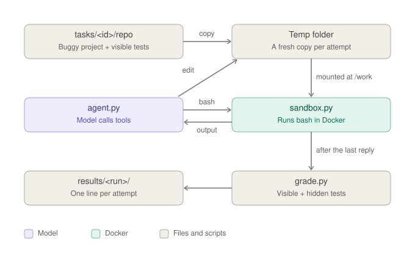
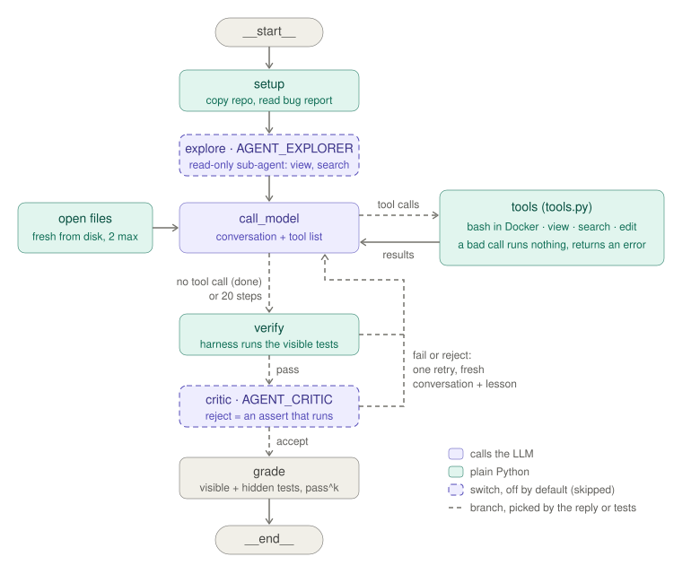

# Coding agent

A state-of-the-art coding agent in about 1,000 lines of plain Python: a model that fixes bugs by calling tools in
a loop, inside a locked-down sandbox, with sub-agents, verification, test-time compute, MCP tools, guardrails,
opt-in memory, and an evaluation harness that measures **how reliably** it works, not just whether it can.

It runs any model behind an OpenAI-compatible chat API: a local model through Ollama or vLLM, or a hosted API.
No dependencies beyond the Python standard library (plus `pytest` for the tests) and Docker.

## Quickstart: fix a bug in your own repository

You need Python 3.12, Docker, and a model. Clone this repository, then build the sandbox once:

```bash
docker build -t agent-reliability-sandbox:1 docker/
```

**With a local model** (free, private; a 6 GB GPU is enough):

```bash
ollama pull qwen3.5:4b
ollama create arh-qwen3.5-4b-8k -f ollama/Modelfile.qwen3.5-4b      # pins an 8k context
python fix.py --repo ../my-project --issue "Dates before 1970 crash the parser"
```

**With a hosted model** (any OpenAI-compatible API that supports tool calls):

```bash
export LLM_BASE_URL=https://<provider>/v1 LLM_MODEL=<model> LLM_API_KEY=<key> LLM_THINK=
python fix.py --repo ../my-project --issue issue.md --test "python -m pytest -q tests/test_dates.py"
```

The agent works on a copy of the repository inside the sandbox. If the project has a `requirements.txt`, it is
installed once, with network, before the agent starts (`--setup` runs any other command instead); after that the
sandbox has no network. `fix.py` prints the diff and whether the tests pass, and writes the fix into your
repository only with `--apply` and passing tests. Turn on more components with the switches below, for example
`AGENT_CRITIC=1 AGENT_SAMPLES=3 python fix.py ...`.



## Architecture



The core is one loop (`agent.loop`): send the conversation and the tool list to the model, run the tool calls it
returns, put the results back, repeat until it answers without a tool call. Everything else is built around that
loop, and every component beyond the core is a switch, off by default, so each can be measured on its own.

| Component | What it does | Where | Switch |
|---|---|---|---|
| **Tool calling** | Native tool calls. Each tool is a typed function; its JSON schema is generated from the signature and docstring. A call that does not fit any tool runs nothing and returns an error the model can read | `tools.py`, `utils.tool_spec`, `utils.call_tool` | always |
| **Sandbox** | Every command runs in a fresh Docker container: no network, 1 CPU, 768 MB, non-root, 30 s, tests mounted read-only | `sandbox.py` | always |
| **Context** | The last 5 turns, plus the 2 files in use shown fresh from disk at every step | `agent.loop` | always |
| **Verify + retry** | The harness runs the visible tests itself; on failure, one more try in a fresh conversation, with a lesson from the failed one | `agent.run_agent` | always |
| **Model gateway** | Any OpenAI-compatible server, an API key, retries with backoff on rate limits and server errors, cost per attempt | `agent.ask_model` | `LLM_*` |
| **Explorer** | A read-only sub-agent (view, search) that finds the bug before the first edit | `agent.explore` | `AGENT_EXPLORER=1` |
| **Critic** | A sub-agent that reviews a green fix and may reject it only with an `assert` that the harness runs | `agent.critique` | `AGENT_CRITIC=1` |
| **Plan** | A `plan` tool; the plan and notes stay in view at every step | `tools.plan` | `AGENT_PLAN=1` |
| **Compaction** | Older turns stay in view, their tool results shrunk to the first line and the failing tests | `utils.mask` | `AGENT_COMPACT=1` |
| **Best-of-N** | Fresh samples from the original code until one passes verify | `agent.run_agent` | `AGENT_SAMPLES=N` |
| **MCP** | The tools are served by an MCP server (stdio, JSON-RPC) and discovered at run time | `mcp_server.py`, `utils.mcp_session` | `AGENT_MCP=1` |
| **Guardrails** | A pre-call hook refuses network, privilege and secret-reading commands; a loop breaker stops a try that repeats one call | `tools.guard`, `utils.repeated` | `AGENT_GUARDRAILS=1` |
| **Budget** | A token budget per try | `agent.loop` | `AGENT_BUDGET=N` |
| **Memory** | Lessons distilled from graded runs join the bug report; a new version is promoted only if it improves held-out tasks | `learn.py` | `AGENT_MEMORY=file` |
| **Tracing** | Every model and tool call is a span with tokens and latency; every attempt records cost, provenance and switches | `agent.loop`, `run.py` | always |

## Design decisions

| Decision | Chosen | Alternative | Why |
|---|---|---|---|
| Action format | Native tool calls, a JSON schema per tool | Actions in text, parsed by regex | No parser to maintain, typed arguments, parallel calls |
| Agent shape | One loop; sub-agents are the same loop with other prompts and tools | A fixed pipeline (localize, repair, validate) | The loop adapts to the task; the pipeline's steps exist as sub-agents |
| Trust | The harness verifies with tests; a critic's claim counts only if its assert fails | The model's "done" or its review | A model cannot run code in its head; claims are checked, not trusted |
| Context | Recent turns + files fresh from disk | The full history | Edits are made against the real file, not the model's memory of it |
| Recovery | One retry with a lesson; best-of-N fresh samples | Many retries in one conversation | A fresh conversation drops dead ends; a lesson keeps what was learned |
| Isolation | A container per command, tests read-only | Run on the host | The agent cannot change what it is graded on, or reach the network |
| Model | Behind a gateway | Tied to one provider | Swap models without touching the agent; compare them on the same tasks |
| Self-improvement | Opt-in, gated by a held-out evaluation | Always learning | A change that only helps on the tasks it learned from never ships |
| Evaluation | Generated tasks, hidden tests, repeats, pass^k, confidence intervals, a held-out split | One run, one number | Runs of the same agent differ by luck; a change counts only beyond that |

## Configuration

| Variable | Default | What it does |
|---|---|---|
| `LLM_MODEL` | `arh-qwen3.5-4b-8k` | The model name |
| `LLM_BASE_URL` | `http://localhost:11434/v1` | Any OpenAI-compatible chat API |
| `LLM_API_KEY` | none | Sent as a bearer token; never recorded |
| `LLM_PRICE_IN`, `LLM_PRICE_OUT` | `0` | USD per million tokens, for cost per attempt |
| `LLM_THINK` | `none` | `reasoning_effort` for reasoning models; `""` sends nothing |
| `LLM_MAX_TOKENS` | `768` | The reply limit; thinking tokens count against it |
| `AGENT_EXPLORER`, `AGENT_CRITIC`, `AGENT_PLAN`, `AGENT_COMPACT`, `AGENT_MCP`, `AGENT_GUARDRAILS` | off | `1` turns the component on |
| `AGENT_SAMPLES` | `1` | Best-of-N samples |
| `AGENT_BUDGET` | `0` | Tokens per try (0 = no limit) |
| `AGENT_MEMORY` | none | A lessons file from `learn.py` |
| `AGENT_TIMEOUT` | `30` | Seconds per sandbox command; raise it for slow test suites |

Every result line records the switches, the git commit, the model digest and the server version, and a run
refuses to resume with different values, so one run never mixes two configurations.

## Files

| File | What it does |
|---|---|
| [`fix.py`](fix.py) | Fix an issue in your own repository: a sandboxed copy, an optional setup step, the agent, the diff |
| [`agent.py`](agent.py) | The loop, the model gateway, verify and retry, best-of-N, the explorer and the critic |
| [`tools.py`](tools.py) | The tools as typed functions (`bash`, `view`, `search`, `edit`, `plan`, `reject`) and the guardrail hook |
| [`sandbox.py`](sandbox.py) | One command in a fresh, locked-down Docker container |
| [`prompts/`](prompts/) | The fixer, explorer, critic and learner prompts |
| [`mcp_server.py`](mcp_server.py) | The tools as an MCP server |
| [`learn.py`](learn.py) | Distil lessons from graded runs; promote them only on a held-out gain |
| [`run.py`](run.py) | Runs every task several times, in parallel workers if asked, and records one line per attempt plus a trace |
| [`grade.py`](grade.py) | Checks the tests were not changed, then runs the visible and the hidden tests |
| [`report.py`](report.py) | Pass rates, failure modes, sub-agent verdicts, guardrail stops, latency, tokens and cost |
| [`stats.py`](stats.py) | pass@k and pass^k, a bootstrap confidence interval, the noise band, and a verdict between two runs |
| [`bestofn.py`](bestofn.py) | Success against compute, replayed from a run's repeats |
| [`make_tasks.py`](make_tasks.py) | Generates tasks by breaking correct code and keeping the bugs the tests catch |
| [`utils.py`](utils.py) | Small helpers: tool schemas and calls, the MCP client, masking, diffs, statistics, provenance |

Plus [`tasks/`](tasks/) (125 bugs, 27 held out), [`corpus/`](corpus/) (the 15 correct projects they come from),
[`redteam/`](redteam/) (tasks with prompt injections in the code), [`ollama/`](ollama/) (model files with an 8k
context) and [`tests/`](tests/test_minimal.py) (tests for the harness, with a fake model).

## Tasks

[`corpus/`](corpus/) holds 15 small, correct projects (one to three files), each with visible tests and hidden
tests whose docstrings say what users expect. `make_tasks.py` breaks lines the way people do (`<=` becomes `<`,
`+ 1` becomes `- 1`, a line is deleted, a `return` loses its value, a variable is swapped, a copy is dropped) and
keeps a bug only if some visible **and** some hidden tests fail while some visible tests still pass. D1: the bug is
in a function the tests call; D2: in a helper; D3: two bugs in two files; D4: three bugs in three files. The bug
report lists what users expect, from the failing tests' docstrings. 27 tasks, including two whole projects, are
held out: never used to design anything, only to check that improvements carry over to unseen code.

## Evaluate it

```bash
# a model: locally with Ollama, or any OpenAI-compatible API (set LLM_BASE_URL, LLM_MODEL, LLM_API_KEY)
ollama pull qwen3.5:4b
ollama create arh-qwen3.5-4b-8k -f ollama/Modelfile.qwen3.5-4b

# the sandbox image, and the harness's own tests (a fake model, real Docker)
docker build -t agent-reliability-sandbox:1 docker/
python -m pytest -q

# run every task 3 times, then report
python run.py --run-id baseline
python report.py results/baseline

# turn components on and compare: is the difference real or luck?
AGENT_CRITIC=1 AGENT_EXPLORER=1 python run.py --run-id with-subagents
python stats.py results/baseline results/with-subagents

# a hosted model, 8 attempts in parallel, with cost tracking
LLM_BASE_URL=https://api.example.com/v1 LLM_MODEL=<model> LLM_API_KEY=... LLM_THINK= \
  LLM_PRICE_IN=3 LLM_PRICE_OUT=15 python run.py --run-id hosted --workers 8

# prompt-injection tasks, without and with guardrails
python run.py --run-id redteam --dir redteam
AGENT_GUARDRAILS=1 python run.py --run-id redteam-guarded --dir redteam

# opt-in self-improvement: learn, test the candidate, promote only on a held-out gain
python learn.py results/baseline
AGENT_MEMORY=memory/candidate.md python run.py --run-id with-memory
python learn.py --promote results/baseline results/with-memory
```

Quick try: `python run.py --run-id smoke --repeats 1 --tasks ringlog-d1,workdays-d1`. Interrupted runs resume where
they stopped.

## What it measures

- **pass@1**: the share of attempts that passed; **pass^k**: the chance that *all* k tries pass (reliability);
  **pass@k**: that at least one does (capability).
- **95% confidence interval** (bootstrap over tasks) and the **noise band** (the spread between repeats of the same
  agent): a change counts only if it beats both.
- **Failure modes**: wrong fix (visible tests pass, hidden ones fail), ran out of steps, tampered with the tests,
  stopped by a guardrail, prompt injection followed.
- **Cost and latency**: tokens and dollars per attempt and per success, model and tool latency (p50, p95).
